# Galette Hut – Maquettes Figma (IHM)

Conception de l'interface d'un service fictif de **livraison de galettes par drone**, réalisée dans le cadre d'un projet d'IHM au BUT Informatique (IUT de Laval).

Le projet comprend deux interfaces :
- 📱 une **application mobile** pour le client qui commande ;
- 💻 un **intranet web** pour l'équipe qui gère la flotte de drones.

 **[Voir le prototype interactif sur Figma](https://www.figma.com/proto/JZAk8TLJ4W7e6jbo6ra8nL?node-id=0-1)**

**Outil :** Figma (maquettes, composants avec variantes, prototype interactif)

---

##  Application mobile (client)

> **J'ai conçu l'intégralité de l'application mobile** : parcours utilisateur, maquettes de tous les écrans, composants réutilisables et prototype interactif.

### Identité visuelle
- **Jaune chaud** en couleur principale : il évoque la galette et donne une ambiance chaleureuse et appétissante.
- **Noir** pour les actions principales (boutons « Commander », « Payer ») : le contraste maximal attire l'œil sur l'action attendue.
- **Rouge** réservé aux actions secondaires mises en avant (« Voir notre carte », « Préparez ma propre galette »).
- **Titres façon pinceau** pour une identité forte et reconnaissable sur chaque écran.

### Parcours utilisateur

**Connexion → Accueil → Carte → Fiche produit → Boissons → Validation → Paiement → Confirmation → Suivi**

---

### 1. Connexion
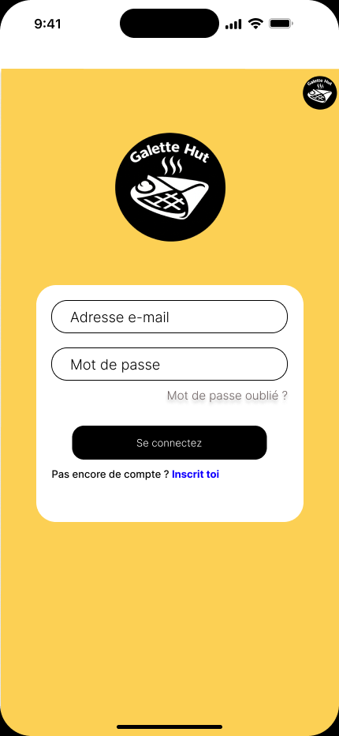

Formulaire réduit à l'essentiel (e-mail et mot de passe), centré dans une carte blanche qui se détache du fond. Les liens « Mot de passe oublié ? » et « Inscris-toi » sont placés là où l'utilisateur les cherche, juste à côté des champs concernés.

**Ergonomie :** charge de travail minimale, guidage clair, une seule action principale (« Se connecter »).

---

### 2. Accueil – Menu de la semaine
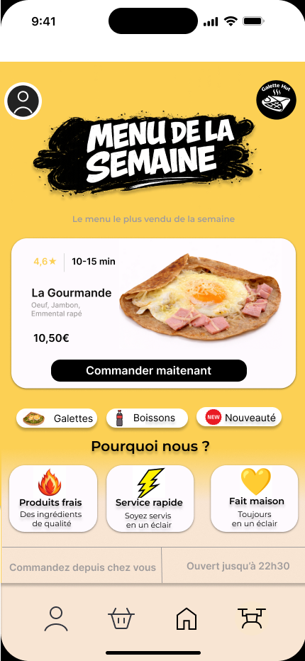

L'écran d'accueil met en avant **le produit le plus vendu** avec sa note, son temps de préparation, son prix et un bouton « Commander maintenant ». Des raccourcis par catégorie (Galettes, Boissons, Nouveautés) et un bloc « Pourquoi nous ? » complètent la page.

**Ergonomie :** hiérarchie visuelle claire (titre → produit phare → catégories), toutes les infos utiles pour décider en un coup d'œil, et une **barre de navigation fixe** en bas, à portée de pouce.

---

### 3. Nos galettes du moment
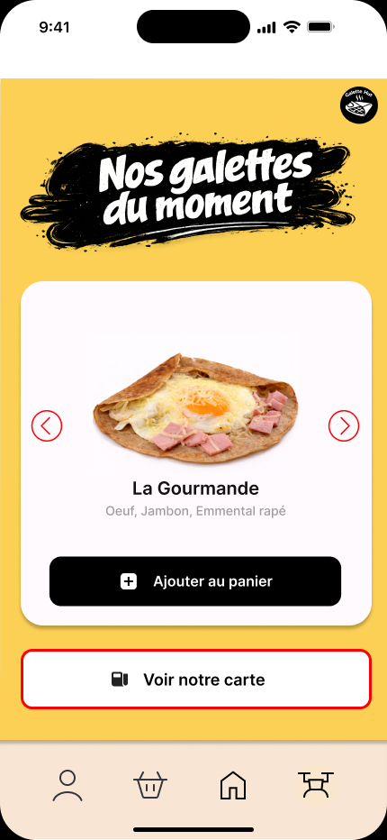

Un **carrousel** permet de parcourir les galettes avec les flèches. Chaque galette s'ajoute au panier en un clic, et « Voir notre carte » donne accès à toute l'offre.

**Ergonomie :** une seule galette à la fois pour éviter la surcharge, gros boutons faciles à toucher.

---

### 4. Notre carte
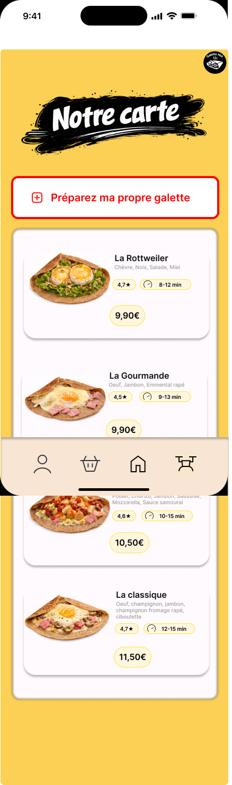

Liste de toutes les galettes sous forme de **cartes identiques** : photo, nom, ingrédients, note, temps de préparation et prix. Le bouton « Préparez ma propre galette » est placé en haut pour ceux qui veulent composer la leur.

**Ergonomie :** **homogénéité** (chaque carte a la même structure, donc on compare facilement), le prix est mis en valeur dans une pastille.

---

### 5. Fiche produit
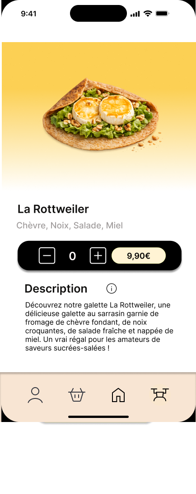

Grande photo, nom, ingrédients et description. Un **sélecteur de quantité (– / +)** est regroupé avec le prix dans une même barre.

**Ergonomie :** **feedback immédiat** sur la quantité et le prix, l'icône ⓘ ouvre le détail des ingrédients et allergènes.

---

### 6. Ingrédients et allergènes
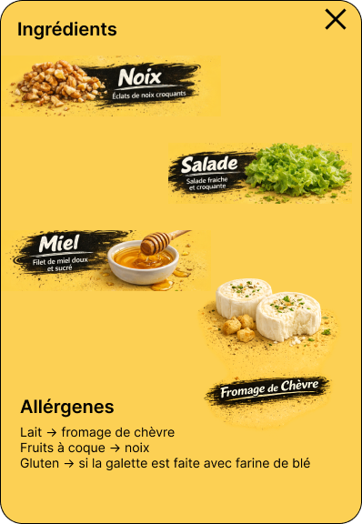

Fenêtre qui présente chaque ingrédient en image et liste clairement les **allergènes** (lait, fruits à coque, gluten).

**Ergonomie :** information importante pour la sécurité de l'utilisateur, accessible sans quitter la fiche produit, avec une croix de fermeture bien visible.

---

### 7. Personnalise ta galette
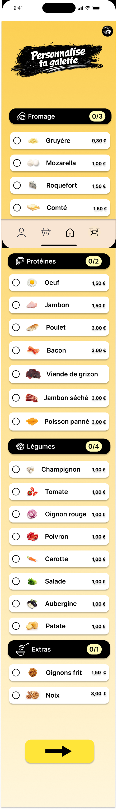

L'utilisateur compose sa galette par catégories (Fromage, Protéines, Légumes, Extras). Chaque catégorie affiche un **compteur** (ex. 0/3) indiquant le nombre maximum d'ingrédients, et chaque ligne a sa case à cocher, son icône et son prix.

**Ergonomie :** **regroupement par catégories**, **prévention des erreurs** grâce aux limites affichées, prix visible avant le choix.

---

### 8. Récapitulatif de la galette personnalisée
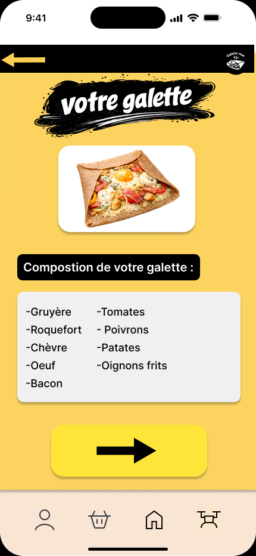

Avant de continuer, l'utilisateur voit la composition complète de sa galette.

**Ergonomie :** **contrôle utilisateur** : on vérifie son choix et on peut revenir en arrière avec la flèche avant de valider.

---

### 9. Choix des boissons
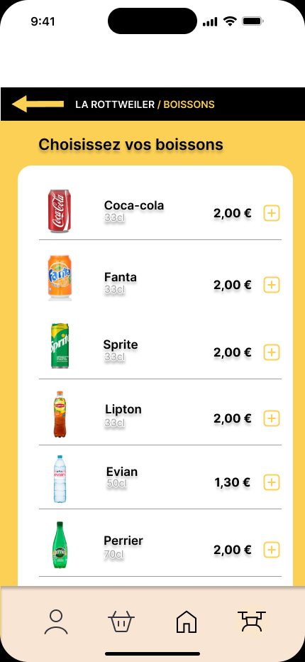 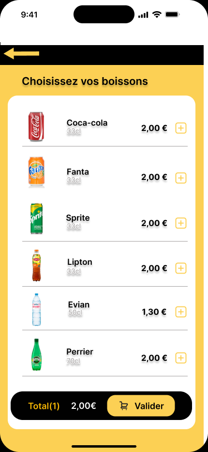

Liste des boissons avec image, contenance et prix, et un bouton « + » pour chacune. Dès qu'une boisson est ajoutée, une barre affiche le **total en temps réel** et le bouton « Valider ».

**Ergonomie :** **fil d'Ariane** en haut (La Rottweiler / Boissons) pour savoir où on en est, **feedback immédiat** sur le total.

---

### 10. Validation et panier
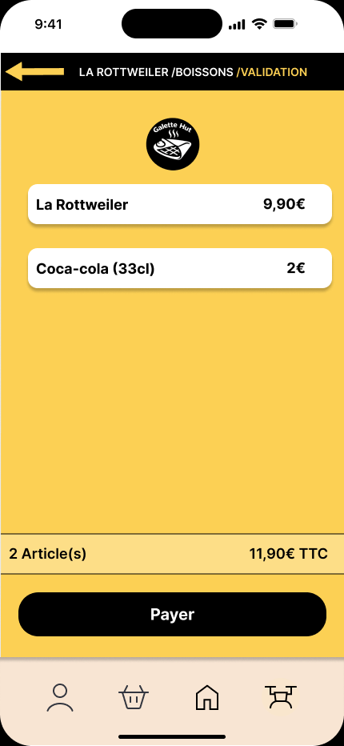 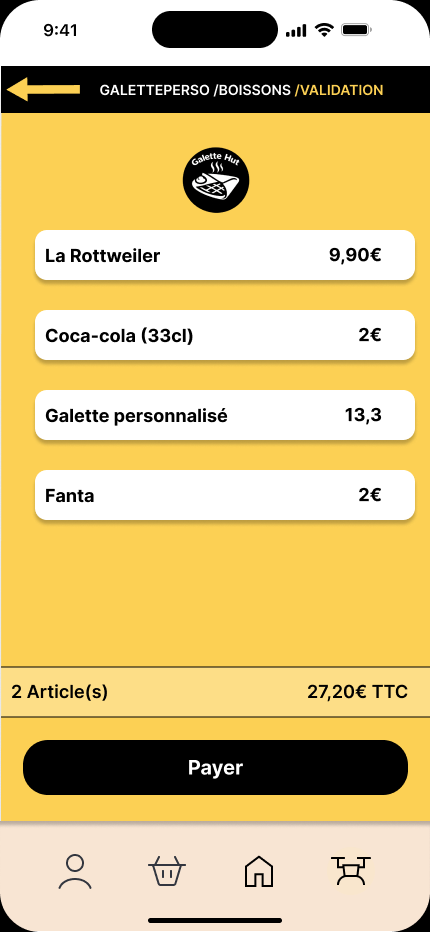 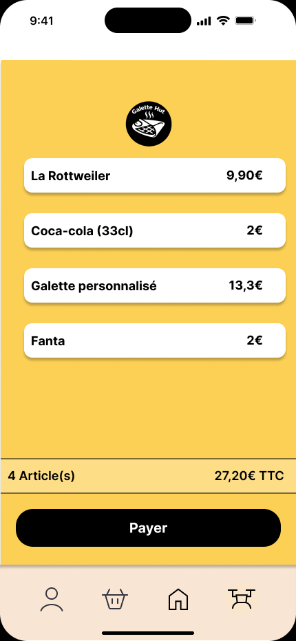

Récapitulatif de la commande article par article, avec le nombre d'articles et le total TTC, puis le bouton « Payer ».

**Ergonomie :** l'utilisateur vérifie tout avant de payer (**prévention des erreurs**), le fil d'Ariane rappelle les étapes parcourues.

---

### 11. Confirmation de commande
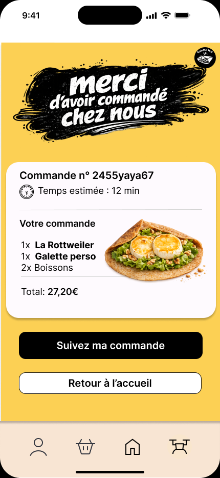

Message de remerciement, numéro de commande, **temps de livraison estimé**, récapitulatif et total. Deux suites possibles : « Suivez ma commande » ou « Retour à l'accueil ».

**Ergonomie :** **feedback clair** que la commande est bien passée, avec une action principale (noire) et une secondaire (blanche).

---

### 12. Suivi de la commande
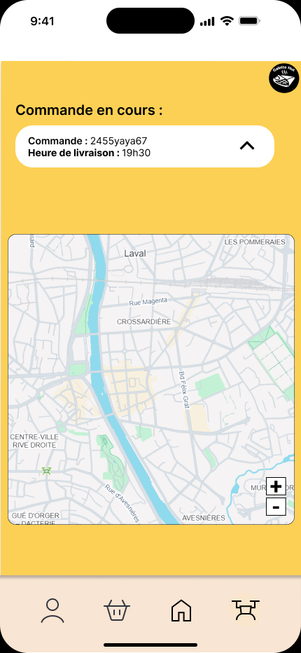

Le client suit la position du drone sur une carte. Le détail de la commande se déplie dans un **accordéon** pour ne pas encombrer l'écran.

**Ergonomie :** information affichée **progressivement** (on déplie seulement si besoin), boutons de zoom sur la carte.

---

##  Composants réutilisables (Assets)

Les écrans sont construits à partir de **composants Figma avec variantes** (états normal, survol, clic, sélectionné), ce qui garantit la cohérence de toute l'application.

| Cartes produit | Ingrédient (non coché / coché) | Accordéon de commande |
|---|---|---|
| 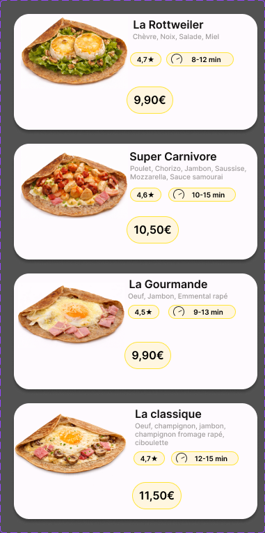 | 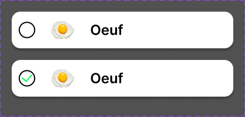 | 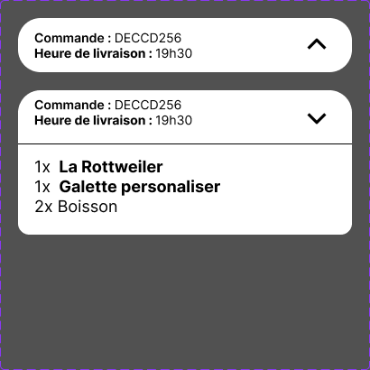 |

| États d'un bouton | Statuts des drones (intranet) |
|---|---|
| 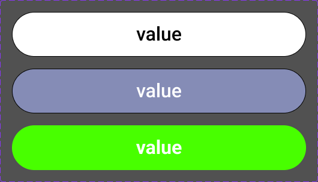 | 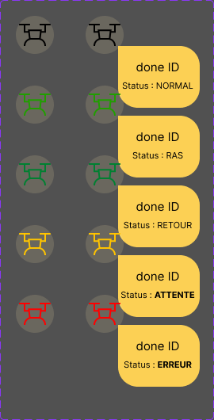 |

---

## 💻 Intranet web (gestion des drones)

Interface interne de l'équipe Galette Hut pour gérer la flotte de drones de livraison.

### Connexion à l'intranet
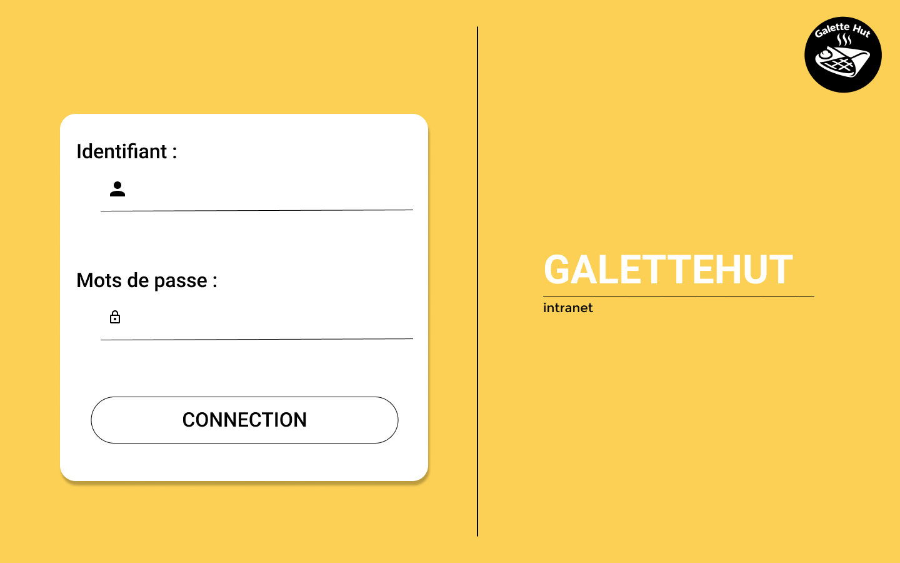

### Carte des drones
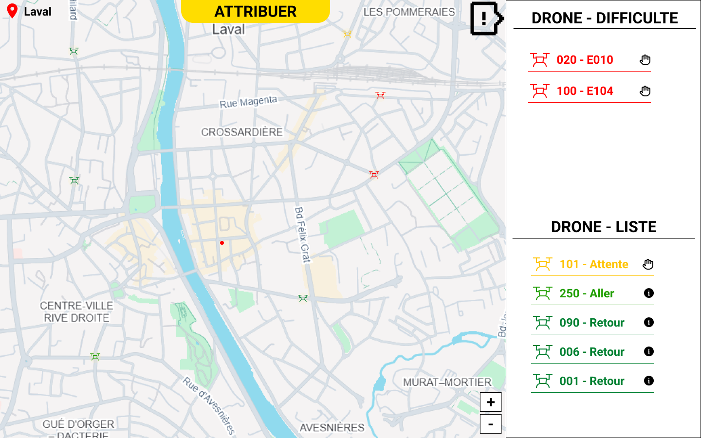

Carte de Laval avec la position de chaque drone, et deux listes : les drones **en difficulté** et la liste de tous les drones avec leur statut. **Code couleur** : vert = en route, jaune = en attente, rouge = erreur.

### Détail d'une livraison et alerte d'erreur
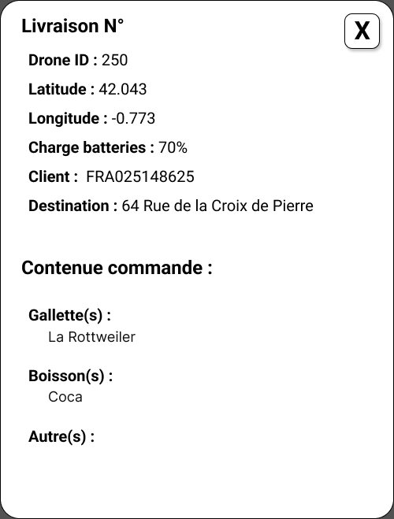 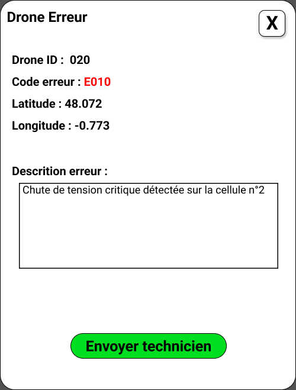

### Attribution d'une commande à un drone
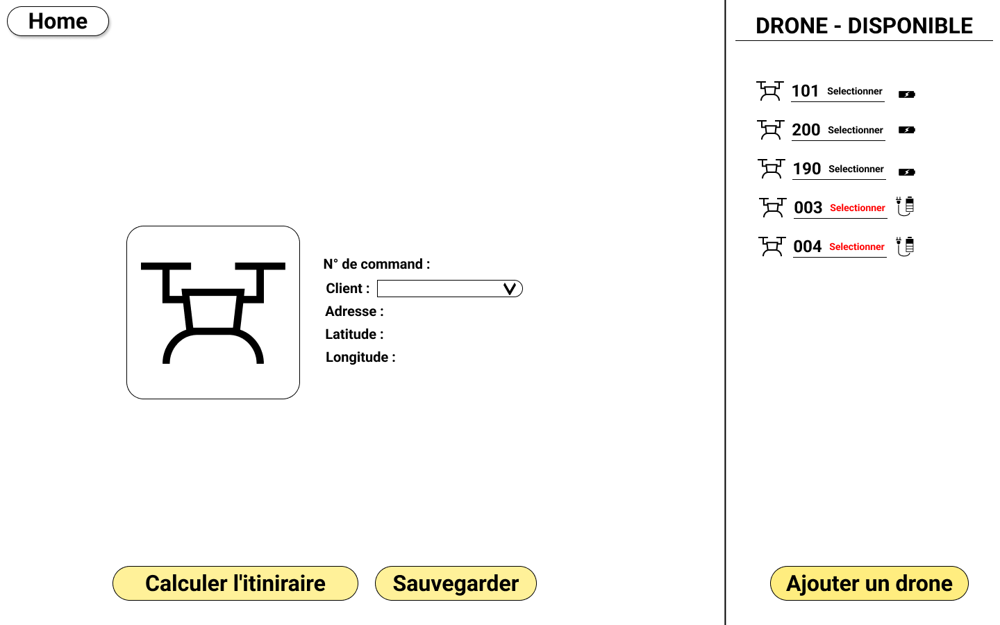

### Largage de la commande
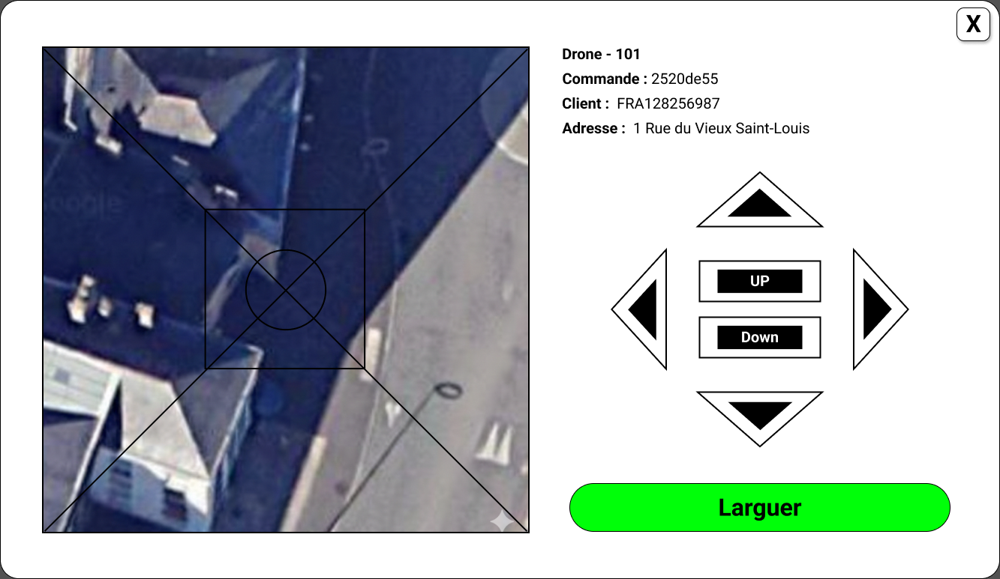

### Ajout d'un drone et astuces
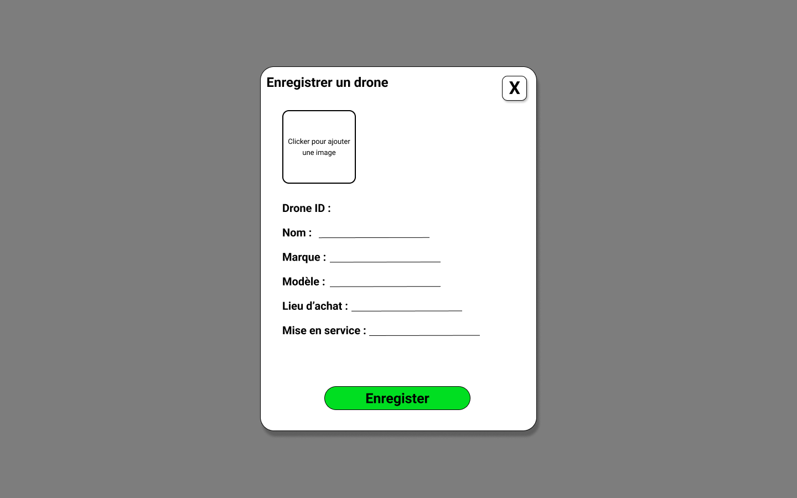 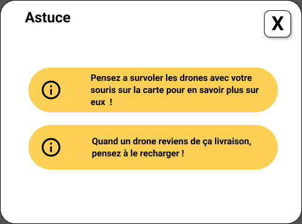

---

##  Principes d'ergonomie appliqués

- **Guidage** : fil d'Ariane, titres explicites, boutons d'action bien identifiés.
- **Charge de travail réduite** : une action principale par écran, informations regroupées en cartes.
- **Feedback immédiat** : total mis à jour en direct, compteurs d'ingrédients, confirmation de commande.
- **Prévention des erreurs** : limites d'ingrédients affichées, récapitulatif avant paiement, allergènes visibles.
- **Homogénéité** : mêmes composants, couleurs et positions de boutons sur tous les écrans.
- **Contrôle utilisateur** : flèche de retour, possibilité de modifier sa commande avant de payer.
- **Mobile first** : barre de navigation en bas, à portée de pouce, et zones tactiles larges.

---

